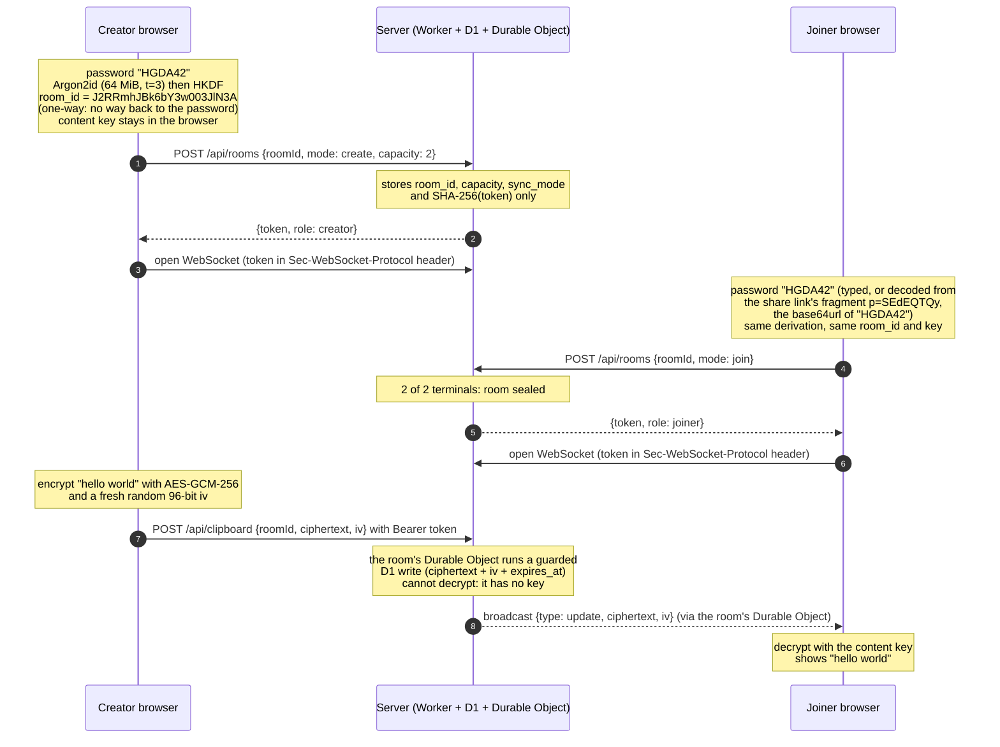

# Clipboard Sharing Online

**🌐 Live: [clipboard-sharing-online.com](https://clipboard-sharing-online.com/)**
· Sibling site: [office-dev-tools.com](https://office-dev-tools.com/)
(privacy-first office & dev tools that run with no backend at all)

Share **text** between devices that agree on a single **password** — with the
server only ever holding **opaque ciphertext** it cannot read.

> 🔒 **End-to-end encrypted — your password never leaves the browser.**
> This isn't a policy promise; it's how the app is built. The password, every
> derived key, and your plaintext are computed and used **only in your browser**.
> The backend is a dumb encrypted key/value store: it sees an opaque room id,
> the AES-GCM ciphertext, the nonce, and timestamps — nothing it can decrypt.
> Open your browser's Network tab and see for yourself.

It is the security-first sibling of
[office-dev-tools.com](https://office-dev-tools.com/)
([`office-tools-online`](https://github.com/JaimeMartinSoler/office-tools-online)):
that app guarantees privacy by having **no backend at all**; this one *must*
relay data between devices, so instead it guarantees privacy with **zero-knowledge
encryption**. Jump to [Privacy by design](#privacy-by-design) for the data flow,
what the server can and cannot see, and the known limitations.

## How it works

1. Open the site and type a **long shared password** — or generate one with
   **Password Safer** (long, high-entropy; the default) or **Password Simple**
   (short, easy to read aloud). A strength meter steers you away from weak ones.
2. On one device, **Create room** — you become its **creator**. The room options
   live under a collapsed **Advanced Settings** panel:
   - **Private room** (default): capped at **Terminals** 1–6 (default 2) and
     **sealed** once full — no further terminal can ever join *that* room
     instance. **Public room**: no limit, never seals.
   - **Sharing mode**, fixed for the room's lifetime:
     - **Broadcast: Push Manual, Pull Auto** (default): you click Push; the
       other terminals receive it **instantly** over an encrypted WebSocket.
     - **Sync: Push & Pull Auto**: the text auto-pushes shortly after you stop
       typing (Push becomes **Sync now**); the others see it live.
     - **Manual: Push & Pull Manual**: the classic explicit flow, no socket at all.
3. On the other devices, **Join room** with the same password — or open the
   room's share link / scan its QR, which joins automatically. Joiners inherit
   the creator's settings.
4. Type or paste text → **Push** (encrypted in your browser, then uploaded).
5. On the other devices: in a live room the text just **appears** (decrypted in
   the browser on arrival); in a manual room click **Pull**. A wrong password
   simply lands in a different room or fails to decrypt — the server can't tell a
   wrong password from a right one. Live rooms have a per-terminal **On update** toggle:
   *overwrite my text* (default) or *warn, keep my edits* (Pull then loads it).
6. **Undo** / **Redo** / **Copy** / **Paste** work on the text pane; **Clear**
   empties it locally (it does not touch the server — Push is what overwrites
   the shared blob). The blob and the whole room auto-expire after a short TTL
   (10 minutes by default).

### Share (every member)

Below the editor, **every** member — creator and joiners — gets **Copy
password**, **Show password**, **Share link** (the native share sheet on
mobile, copy on desktop), and **Show QR** (already open on a PC, ready to scan
with a phone), with a short reminder that anyone
holding the password or link can join. The link is
`https://clipboard-sharing-online.com/#p=<base64url(password)>`: the password
rides in the URL **fragment**, which browsers never send to the server, so it
doesn't reach logs or analytics. The app auto-joins, then scrubs the fragment
from the address bar. The QR is rendered locally by a vendored encoder — no
third-party service.

### Creator controls

The creator gets extra tools (enforced at the server, not just the UI):

- A **Terminals** table (role + connected time; **no IPs are stored**) with a
  **Remove** button to revoke a joiner — in live rooms it also cuts their
  socket at once. A revoked slot stays sealed; it never reopens for a stranger.
  The table refreshes itself in live rooms (and via **Refresh** in any room).
- **Remove room** deletes the content, all members, and the room instantly.
- The **Expiry** selector (1 minute / 10 minutes / 1 hour) sets the TTL sent
  with the next Push.

Joiners get a focused view: the shared editor, the share options, and
**Leave** (forfeit their slot).

## Privacy by design

- **Encrypt before egress.** All content is AES-GCM-256 encrypted client-side
  *before* any network call.
- **Zero-knowledge server.** It stores an opaque `room_id`, the `ciphertext`,
  the `iv`, timestamps, and a little plaintext room metadata (`capacity`,
  `sealed`, `sync_mode`) plus per-member **token hashes** and a
  `creator`/`joiner` **role** — never the password, keys, plaintext, or IP
  addresses. Live sync changes nothing here: the WebSocket broadcasts carry the
  same ciphertext, fanned out by a per-room Durable Object that stores no
  content.
- **Ephemeral.** Rooms, memberships, and blobs share one TTL (10 min default,
  1 h max) and auto-expire (lazy delete on read + a cleanup cron).
- **Bounded blast radius.** Ciphertext is capped at 256 KiB, the API is
  rate-limited per IP, and v1 is text only — no file uploads.
- **Strict CSP.** [`public/_headers`](public/_headers) limits `connect-src` to
  `'self'` (the same-origin API), the explicit same-origin `wss://` hosts for
  live sync, plus the cookieless Cloudflare Web Analytics beacon — no other
  third-party egress.
- **Sealed rooms (defense-in-depth).** A private (capped, sealable) room protects content
  against a *later* password compromise. It is access control on top of the
  encryption, never a substitute — and membership is strictly in-memory, so a
  reload forfeits the slot. A creator can instead choose a **public room** (no
  terminal limit, never seals); the E2EE and every other guard are unchanged.

### Worked example: `hello world` with password `HGDA42`

A creator and a joiner both type the password `HGDA42`. Each browser derives the
same keys **independently** — nothing secret is exchanged, and nothing secret
reaches the server. The values below are real: they are what this app's
[`src/lib/crypto.ts`](src/lib/crypto.ts) produces. A 16-byte `room_id` is 22
base64url characters, a 96-bit `iv` is 16, and `hello world` (11 bytes + the
16-byte GCM tag) is 36. The `room_id` is always the same for `HGDA42`; the `iv`
and ciphertext are fresh random values on every push.

> **Don't reuse this example.** This README is public, so the `HGDA42` room is
> effectively a public room: anyone trying the example on the live site lands in
> the same real room (or finds it sealed). Never put real data behind an example
> password.



| Step | Creator's browser | Over the wire / stored by the server | Joiner's browser |
| --- | --- | --- | --- |
| Password | `HGDA42` — never sent | *nothing* | `HGDA42` — never sent (a share link carries it only in the `#p=SEdEQTQy` fragment — `SEdEQTQy` is the **base64url** of `HGDA42`, an encoding, not encryption — and browsers never transmit the fragment) |
| Key derivation | `HGDA42` → Argon2id → HKDF → `room_id` + non-extractable AES-GCM-256 key. One-way: the `room_id` is computed **from** the password, never the reverse | *nothing* | the same `room_id` and key, derived independently |
| Create / join | `POST /api/rooms` | `roomId: "J2RRmhJBk6bY3w003JlN3A"`, `capacity: 2`, `sync_mode`, **SHA-256** of each member's token | `POST /api/rooms` (join seals the room at 2/2) |
| Push | encrypts `hello world` | `ciphertext: "-qL_WXESlD0rkZ1D8gz0MzS1iubqNJtYQtcY"`, `iv: "jCoWtKInemep78L2"`, `expires_at` | — |
| Delivery | — | the same `{ciphertext, iv}` pushed over `wss://` by the room's Durable Object | decrypts to `hello world` |
| Wrong password `HGDA43` | — | derives `room_id: "_GuINxgV8Tsi-Z1twn9-yw"`, a completely different room → join gets `404` | — |

**The `room_id` is derived from the password, and the password cannot be
recovered from the `room_id`.** Argon2id and HKDF are one-way functions:
holding `J2RRmhJBk6bY3w003JlN3A` gives no way to compute `HGDA42` backwards. What it does
allow is **checking guesses**: the derivation is public and deterministic, so
anyone can derive a candidate password and see whether it lands on the same
`room_id`. Six uppercase letters and digits is a small search space — **it is a
weak password** (and now a published one), and that guess-and-check attack is
exactly the fixed-salt trade-off below. Argon2id makes every guess expensive (64 MiB of memory each),
which defeats long random passphrases but not short common ones. The strength
meter flags weak passwords; real rooms should use the generated **Password
Safer**.

### What the server can and cannot see

| The server **can** see | The server **can never** see |
| --- | --- |
| Opaque `room_id` — derived one-way from the password; it can't be reversed, only checked against guesses | The password |
| AES-GCM `ciphertext` + `iv`, and so the approximate text length | The Argon2id master key or the AES content key |
| Timestamps: created, expires, member joined | The plaintext |
| Room settings: `capacity`, `sealed`, `sync_mode` | Raw membership tokens (only their SHA-256 hashes are stored) |
| Member roles (`creator` / `joiner`) | The share-link fragment (`#p=…`, the base64url-encoded password) |
| Request timing and the source IP in transit (used only for in-memory rate limiting, **never stored by this app**) | IP addresses at rest in the app's database, accounts, or any other PII |

The app never persists IPs, but it runs on Cloudflare: the platform itself (edge
and Worker logs, analytics) may see or retain request IPs under Cloudflare's own
policies. It never sees anything more than ciphertext, though.

### Crypto, in one paragraph

`Argon2id(password, fixed app salt)` (64 MiB, 3 iterations, via `hash-wasm`)
derives 32 bytes of master key material. `HKDF-SHA-256` splits that into a
deterministic, opaque 16-byte **`room_id`** (the only key-derived value ever
sent) and a non-extractable **AES-GCM-256 content key** (never sent). Each push
uses a fresh random 96-bit `iv`; the GCM tag makes tampering detectable — a
modified blob fails to decrypt rather than yielding altered text. Membership is
a random bearer token per terminal, stored server-side only as a SHA-256 hash.
Full details: [`docs/SECURITY.md`](docs/SECURITY.md) and
[`docs/ARCHITECTURE.md`](docs/ARCHITECTURE.md).

### Known limitations (stated honestly)

- **Fixed salt ⇒ offline guessing.** The password is the only shared secret, so
  derivation must be deterministic and the salt is a public app-wide constant.
  An attacker can try passwords offline, and one precomputation works against
  every user. Mitigations: memory-hard Argon2id, strong-passphrase nudging,
  short TTL, and sealed rooms — but **a weak password is the dominant risk**.
- **You trust the served code.** A malicious or compromised frontend build could
  exfiltrate plaintext. The strict CSP and an inspectable Network tab narrow
  this; they don't eliminate it.
- **Metadata leaks.** Anyone watching the server learns that *some* room was
  written or read, when, and roughly how big the ciphertext is — not what it says.
- **The link is the key.** base64url is encoding, not encryption: whoever holds
  the share link (or the password) can join and decrypt.
- **Availability over convenience.** Someone who knows the password at the same
  time can take the last slot of a private room and lock you out, and a reload
  forfeits your own slot. Confidentiality is never weakened by either.
- **Analytics beacon.** The site loads cookieless Cloudflare Web Analytics; it
  sees page paths, never the fragment, keys, or content.
- **Compromised endpoints** (malware, hostile extensions) see plaintext — no
  E2EE can help there.

The full threat model, the sealing analysis, and the out-of-scope threats are
in [`docs/SECURITY.md`](docs/SECURITY.md).

## Tech stack

- [Next.js 15](https://nextjs.org/) (App Router) — **static export** → Cloudflare Pages
- [TypeScript](https://www.typescriptlang.org/) (strict, no `any`) + the `Result<T>` pattern
- [Tailwind CSS v4](https://tailwindcss.com/) + shadcn-style UI primitives
- [hash-wasm](https://github.com/Daninet/hash-wasm) (Argon2id) + WebCrypto (HKDF, AES-GCM)
- [Hono](https://hono.dev/) on a [Cloudflare Worker](https://workers.cloudflare.com/) bound to [Cloudflare D1](https://developers.cloudflare.com/d1/), plus a per-room [Durable Object](https://developers.cloudflare.com/durable-objects/) ([WebSocket Hibernation](https://developers.cloudflare.com/durable-objects/best-practices/websockets/)) for live sync
- [Vitest](https://vitest.dev/) (+ [`@cloudflare/vitest-pool-workers`](https://developers.cloudflare.com/workers/testing/vitest-integration/) for the Worker)
- [pnpm](https://pnpm.io/) workspaces

## Repository layout

```
.                       # package "clipboard-sharing-online": Next.js frontend
├─ src/
│  ├─ app/              # page.tsx (the tool + landing content below it), the
│  │                    # content pages (share-text-between-phone-and-pc/,
│  │                    # security/), privacy/, about/, sitemap.ts,
│  │                    # layout.tsx
│  ├─ components/       # StatusBanner, Hint, ui/* primitives, the tool
│  │                    # (entry, editor, share options, creator panel),
│  │                    # landing/content-page/FAQ/footer blocks
│  └─ lib/              # crypto.ts, api.ts, live.ts, room-link.ts, qr.ts,
│                       # password-gen.ts, preferences.ts, pages.ts, faq.ts,
│                       # … (each with a co-located *.test.ts)
├─ public/_headers      # strict CSP
└─ worker/              # package "worker": Cloudflare Worker API
   ├─ src/{index,db}.ts # Hono app + D1 queries
   ├─ src/room-do.ts    # RoomDO: per-room WebSocket fanout (hibernated)
   ├─ migrations/       # 0001_init, 0002_roles_sealed, 0003_sync_mode
   ├─ wrangler.toml     # D1 + DO bindings, /api/* route, cron, vars
   └─ test/             # vitest-pool-workers against a local D1
```

## Getting started

**Prerequisites:** Node.js 22+ and pnpm 11 (`corepack enable pnpm`).

> **Build note:** `next build` would otherwise crash inside webpack's hasher
> (`Cannot read properties of undefined (reading 'length')`). The fix lives in
> [`next.config.mjs`](next.config.mjs) (a crypto SHA-256 `hashFunction` that
> no-ops on empty updates). Keep that override.

```bash
pnpm install

# Frontend (static export → ./out)
pnpm dev          # http://localhost:3000
pnpm build        # emits ./out
pnpm lint
pnpm test         # every src/**/*.test.ts (crypto, api, live sync, prefs, …)

# Worker API (local Wrangler + a simulated D1)
pnpm --filter worker exec wrangler d1 migrations apply clipboard-sharing-online --local
pnpm --filter worker dev          # http://127.0.0.1:8787
pnpm --filter worker test         # vitest-pool-workers against a local D1
pnpm --filter worker lint         # tsc --noEmit

# Both test suites at once
pnpm -r --include-workspace-root test
```

In production the Worker is bound to `/api/*` on the same custom domain as Pages,
so the browser talks to it **same-origin** (no CORS). For local development run
both dev servers side by side: `next.config.mjs` rewrites proxy the HTTP `/api/*`
calls from `:3000` to `:8787`, while the live-sync **WebSocket connects straight
to `ws://127.0.0.1:8787`** (Next's dev proxy cannot carry WebSocket upgrades;
`src/lib/live.ts` handles this automatically on localhost).

## Deploy

The two environments are **fully decoupled** — each has its own frontend, Worker,
and D1, served **same-origin** on a single host (the Worker route takes precedence
over Pages for `/api/*`; everything else is the static export):

| Environment | Host | Frontend (Pages) | API (Worker route → D1) |
| --- | --- | --- | --- |
| production | `clipboard-sharing-online.com` | `main` branch | `…/api/*` → `clipboard-sharing-online-api` → `clipboard-sharing-online` D1 |
| develop | `develop.clipboard-sharing-online.com` | `develop` branch | `…/api/*` → `clipboard-sharing-online-api-develop` → `clipboard-sharing-online-develop` D1 |

The routes and D1 bindings are declared in
[`worker/wrangler.toml`](worker/wrangler.toml) (top level = prod, `[env.develop]`
= staging). The steps below are the one-time console/CLI setup that has to exist
for those declarations to have something to bind to.

### One-time Cloudflare setup

This is the exact sequence that gets a working, decoupled prod + develop. Do it
once; afterwards CI keeps both in sync.

**1. Own the domain in Cloudflare.** Add `clipboard-sharing-online.com` as a zone
(nameservers pointed at Cloudflare) so you can attach proxied hostnames and Worker
routes to it.

**2. Create the two D1 databases** and copy each printed `database_id` into
`worker/wrangler.toml` (prod → top-level `[[d1_databases]]`, develop →
`[[env.develop.d1_databases]]`):

```bash
pnpm --filter worker exec wrangler d1 create clipboard-sharing-online
pnpm --filter worker exec wrangler d1 create clipboard-sharing-online-develop
```

`database_id` is an identifier, not a secret — it is safe to commit. Access is
gated by the account-scoped API token, not by knowing the id.

**3. Create the API token** (My Profile → API Tokens → Create Custom Token) with
**all** of these — a token missing the zone scopes deploys the Worker but silently
fails to create its `/api/*` route:

| Scope | Type | Permission | Needed for |
| --- | --- | --- | --- |
| Workers Scripts | Account | Edit | Upload/deploy the Worker |
| D1 | Account | Edit | `d1 migrations apply --remote` |
| Cloudflare Pages | Account | Edit | Frontend Pages deploy |
| Workers Routes | Zone | Edit | Bind `…/api/*` to the Worker |
| Zone | Zone | Read | Resolve `zone_name` → zone id |
| Account Settings | Account | Read | List the account (usually auto-included) |

Scope Zone Resources to `clipboard-sharing-online.com`. Save it as the
`CLOUDFLARE_API_TOKEN` GitHub secret, alongside `CLOUDFLARE_ACCOUNT_ID` and
`CLOUDFLARE_PROJECT_NAME` (the Pages project).

**4. Wire production** (`clipboard-sharing-online.com`):

- Pages → your project → **Custom domains → add `clipboard-sharing-online.com`**.
  A Pages custom domain serves the project's **production branch** (`main`).
- Workers → `clipboard-sharing-online-api` → **Routes → add
  `clipboard-sharing-online.com/api/*`** (zone `clipboard-sharing-online.com`).
  This matches the `[[routes]]` block in `wrangler.toml`; adding it in the dash
  is equivalent and useful if a token ever deploys without the route scope.

**5. Wire develop** (`develop.clipboard-sharing-online.com`) — the tricky part.
Pages custom domains only serve the **production** branch, so to put the
**`develop`** branch on a custom subdomain you point the custom domain at the
branch's `*.pages.dev` alias:

- **DNS → add a proxied (orange-cloud) `CNAME`**: name `develop`, target
  `develop.clipboard-sharing-online.pages.dev` (the develop-branch alias). Proxied
  is required — Worker routes only fire on proxied hostnames.
- Pages → same project → **Custom domains → add
  `develop.clipboard-sharing-online.com`**. Combined with the CNAME above, Pages
  serves the **develop** branch on this host (not `main`), with a real edge cert
  (this is what clears the `522` you get from the CNAME alone).
- Workers → `clipboard-sharing-online-api-develop` → **Routes → add
  `develop.clipboard-sharing-online.com/api/*`** (zone
  `clipboard-sharing-online.com`), mirroring the `[[env.develop.routes]]` block.

**Test each host** (never the `*.pages.dev` URL — no Worker route covers it, so
its `/api/*` always `405`s):

```bash
# Expect a JSON body (e.g. 400), NOT a 405 — 405 means the request hit Pages,
# i.e. the Worker route isn't bound to that host.
curl -i -X POST https://clipboard-sharing-online.com/api/rooms \
  -H 'content-type: application/json' -d '{}'
curl -i -X POST https://develop.clipboard-sharing-online.com/api/rooms \
  -H 'content-type: application/json' -d '{}'
```

**Troubleshooting the two failures we hit:**

- **`405` on `POST /api/…`** — the request reached **Pages**, not the Worker.
  Static Pages only serves `GET`/`HEAD`, so a `POST` returns `405`. Cause: the
  Worker `/api/*` route isn't bound to that host (step 4/5), or you're browsing
  the `*.pages.dev` URL, which no route covers.
- **`522` on the root page** — Cloudflare can't serve the host because it isn't a
  registered **Pages custom domain** yet (the proxied CNAME alone isn't enough).
  Add it under Pages → Custom domains (step 5).

### CI workflows

- **Frontend → Cloudflare Pages** ([`.github/workflows/deploy.yml`](.github/workflows/deploy.yml)):
  `main` = production, other branches = the `develop` staging slot. Output `./out`.
- **Worker → Wrangler** ([`.github/workflows/deploy-worker.yml`](.github/workflows/deploy-worker.yml)):
  applies D1 migrations (`--remote`) then `wrangler deploy`. `main` deploys the
  production Worker; `develop` deploys an isolated staging Worker
  (`clipboard-sharing-online-api-develop`) with its own D1 via `--env develop`
  (see the `[env.develop]` block in [`worker/wrangler.toml`](worker/wrangler.toml)).
- **CI** ([`.github/workflows/verify.yml`](.github/workflows/verify.yml)): runs
  frontend test/lint/build and the Worker test/typecheck on every PR.

All secrets and bindings live on the Worker; the frontend ships none.

## Documentation

- [`docs/SECURITY.md`](docs/SECURITY.md) — guarantees, the fixed-salt trade-off, threat model.
- [`docs/ARCHITECTURE.md`](docs/ARCHITECTURE.md) — crypto, API, D1 schema, expiry, live sync.
- [`docs/SPEC.md`](docs/SPEC.md) — product spec & UX.
- [`docs/STYLE_MIGRATION.md`](docs/STYLE_MIGRATION.md) — shared visual-style change log for sibling sites.
